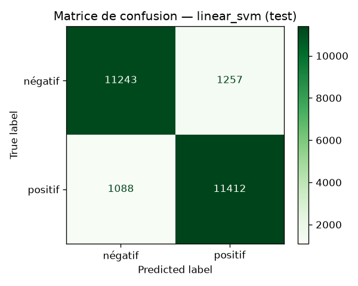

# Analyse de sentiment — critiques de films IMDB

Classification automatique de critiques de films en **positif** ou **négatif**, entraînée
sur les 50 000 critiques du dataset [IMDB Large Movie Review](https://huggingface.co/datasets/stanfordnlp/imdb)
(Stanford, hébergé sur Hugging Face). Le dataset est téléchargé automatiquement au premier
lancement.

## Résultats

Trois modèles TF-IDF sont comparés sur un jeu de validation (10 % du train). Le meilleur est
réentraîné sur tout le train, puis évalué **une seule fois** sur les 25 000 critiques de test.

| Modèle | Accuracy (validation) | F1 (validation) | ROC AUC (validation) | Entraînement |
|---|---|---|---|---|
| Naive Bayes | 88,4 % | 88,3 % | 0,954 | 11 s |
| Régression logistique | 90,6 % | 90,7 % | 0,969 | 12 s |
| **SVM linéaire (calibré)** | **90,6 %** | **90,6 %** | **0,970** | 12 s |

**Modèle retenu — SVM linéaire, sur le jeu de test (25 000 critiques) :**

| Accuracy | F1 | ROC AUC |
|---|---|---|
| **90,6 %** | **90,7 %** | **0,967** |



Détail dans [`results/metrics.json`](results/metrics.json).

## Démarche

1. **Données** — téléchargement des fichiers Parquet depuis Hugging Face, mis en cache dans `data/`.
2. **Nettoyage** — suppression du HTML (`<br />`) et des URLs, minuscules, réduction des
   lettres répétées (`sooooo` → `soo`). Les `!`, `?` et apostrophes des négations sont gardés.
3. **Vectorisation** — TF-IDF sur unigrammes et bigrammes (pour capter « not good »),
   `sublinear_tf`, 200 000 termes maximum.
4. **Modèles** — Naive Bayes, régression logistique, SVM linéaire avec calibration des
   probabilités.
5. **Sélection et évaluation** — choix sur la validation, mesure finale sur le test.

## Utilisation

```bash
python -m venv .venv
.venv\Scripts\activate            # Windows  (Linux/macOS : source .venv/bin/activate)
pip install -e ".[dev]"

python -m sentiment.train         # télécharge IMDB, entraîne, sauvegarde le modèle
python -m sentiment.predict "An absolute masterpiece, the acting was brilliant." "Not good. The ending was boring."
```

```
positif  (89.3% positif)  An absolute masterpiece, the acting was brilliant.
négatif  (1.3% positif)  Not good. The ending was boring.
```

Tests :

```bash
pytest
```

## Structure

```
src/sentiment/
  data.py         téléchargement et chargement du dataset
  preprocess.py   nettoyage du texte
  models.py       pipelines TF-IDF + classifieurs
  train.py        entraînement, sélection, évaluation, export
  predict.py      prédiction en ligne de commande
tests/            tests du nettoyage et des modèles
results/          métriques et matrice de confusion
```

## Limites

- Le modèle est entraîné sur des critiques **en anglais** ; il n'est pas adapté au français.
- Une approche par sac de mots gère mal l'ironie et les négations complexes : « not bad at
  all » n'est jugé positif qu'à 55 %. Un modèle de type transformer (BERT) ferait mieux, au
  prix d'un entraînement bien plus coûteux.

## Stack

Python · scikit-learn · pandas · PyArrow · matplotlib · pytest
